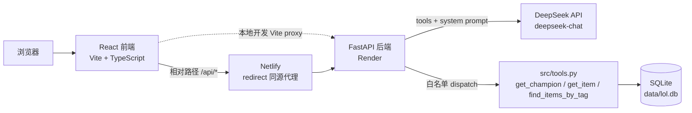

# LOL-RAG · 英雄联盟数据 Agent

[](https://lol-rag.netlify.app)
[](https://www.python.org/)
[](https://fastapi.tiangolo.com/)
[](https://react.dev/)
[](https://www.sqlite.org/)
[](LICENSE)

**English TLDR** — A League of Legends data Q&A agent built from scratch. It pulls the official
Riot Data Dragon dataset into SQLite (173 champions, 254 purchasable Summoner's Rift items,
patch 16.22.1), exposes three whitelisted function-calling tools, runs a hand-written tool loop
with DeepSeek, and ships a React chat UI that visualizes every tool call. FastAPI backend on
Render, static frontend on Netlify. No LangChain, no ORM, no vector database — the whole loop is
small enough to read end to end.

**中文定位** — 一个从 0 手写、可以完整读懂的 LLM Agent 落地项目：用官方数据回答英雄/装备/技能问题，
答案必须来自工具查询而不是模型记忆；前端把每一次工具调用摊开给用户看。

- 在线体验：**https://lol-rag.netlify.app**
- 代码仓库：<https://github.com/wml516518/lol-rag>
- 数据版本：**16.22.1** · 英雄 **173** · 装备 **254**（召唤师峡谷可购买）

---

## 它解决什么问题

问「锤石的 Q 技能是什么？」这类问题时，直接问大模型会得到两种坏答案：记错版本、或者编造。
LOL-RAG 的做法是把事实来源固定成官方数据，模型只负责理解问题、选择工具、组织语言：

1. 后端把三个工具的 JSON Schema 和系统提示词一起发给 DeepSeek；
2. 模型决定调用 `get_champion` / `get_item` / `find_items_by_tag`；
3. 后端在白名单里执行真实函数，把结果回填给模型；
4. 模型基于工具返回的数据作答，并把这一轮的工具调用轨迹返回给前端展示。

一句话：**模型不许背答案，只能查答案。**

## 项目亮点

- **官方数据，不是爬虫**：英雄、技能、装备全部来自 Riot Data Dragon `zh_CN` 数据，版本自动跟随最新。
- **手写 function calling 白名单**：三个工具、字典映射分发，`eval` / `getattr` 这类动态执行一律不用——
  模型能调用的函数边界由代码写死。
- **工具调用轨迹可视化**：前端每条助手回复下方都有可折叠的「工具调用」面板（工具中文名 + 参数 + 结果摘要），
  Agent 是不是真的查了数据，用户一眼能看见。
- **数据干净优先**：863 件原始装备里只入库 254 件召唤师峡谷可购买装备，过滤掉任务道具、娱乐模式道具和下架装备。
- **前后端分离部署**：React 静态站点在 Netlify，FastAPI 在 Render，前端只请求相对路径 `/api/*`，
  由 Netlify 同源代理到后端（无 CORS 配置负担，key 也不会出现在浏览器里）。
- **开箱即用**：`data/lol.db` 直接提交进仓库（约 620 KB），clone 下来不用联网拉数据就能跑。

## 架构



一次 `/api/chat` 请求里，后端最多进行 6 轮「模型要工具 → 执行 → 回填」，超过上限就强制模型收尾回答；
每轮实际调用过的工具会整理进响应的 `trace` 字段，只包含工具名、参数、成功与否和结果，不泄漏内部堆栈。

## 里程碑

| 阶段 | 状态 | 内容 |
| --- | --- | --- |
| **M0 数据地基** | ✅ 完成 | Data Dragon → 归一化 → SQLite。**173 英雄**（含被动与 Q/W/E/R 技能纯文本说明）、**254 装备**（含纯文本效果说明）、版本 **16.22.1**，`meta` 表记录版本号 |
| **M1 Agent 问答** | ✅ 完成 | 3 个查询工具 + 系统提示词（强制查工具、禁止编造）+ 白名单 `dispatch` + 带 tool call 回填的对话循环 + 命令行问答 |
| **M2 检索层** | 🚧 路线图 | 攻略/wiki 等非结构化文本 → embedding → 手写余弦相似度检索（`src/ingest.py`、`src/retrieve.py` 已留位） |
| **M3 Agentic 融合** | 🚧 路线图 | Agent 自主判断：结构化事实走 SQL，开放性问题走向量检索，必要时两者融合 |
| **M4 前端 + 部署** | ✅ 完成 | React 聊天页（深色主题、工具轨迹、建议问题、移动端适配）+ FastAPI 后端；Netlify 前端、Render 后端 |

## 技术栈

| 层 | 选型 |
| --- | --- |
| 数据 | Riot Data Dragon（`zh_CN`，16.22.1）、SQLite |
| Agent | DeepSeek `deepseek-chat`、手写 function calling 循环、白名单工具分发 |
| 后端 | Python 3.13 / FastAPI / uvicorn / httpx / Pydantic |
| 前端 | React 18 / TypeScript / Vite / 纯 CSS（不引 UI 框架） |
| 工程 | uv（依赖与虚拟环境）、pytest / vitest、GitHub + Netlify + Render |

## 目录结构

```text
lol-rag/
├── src/                      # 学习主线：数据 → 工具 → Agent 循环
│   ├── fetch_data.py         # M0：拉取 Data Dragon、归一化（含技能/装备纯文本）、写入 SQLite
│   ├── db.py                 # SQLite 读写层，含旧库自动补列迁移
│   ├── tools.py              # M1：get_champion / get_item / find_items_by_tag
│   ├── agent.py              # M1：工具说明书、系统提示词、dispatch、function calling 循环、CLI
│   ├── config.py             # 路径、Data Dragon 地址、.env 读取
│   ├── ingest.py             # M2 占位：embedding 入库
│   └── retrieve.py           # M2 占位：向量检索
├── backend/                  # FastAPI 后端（Render 部署，rootDir=backend）
│   ├── app/main.py           # /api/health、/api/chat、限流、CORS、启动自检
│   ├── app/chat.py           # 带 trace 的 function calling 循环（最多 6 轮工具）
│   ├── app/db_bridge.py      # 复用 src/ 的 prompt 与工具，读 data/lol.db
│   ├── app/settings.py       # 环境变量 + 本地 .env
│   ├── app/schemas.py        # 请求校验：role 仅 user/assistant、content 1..2000、最多 20 条
│   └── tests/                # 离线测试（假 LLM，不触网、不花 token）
├── frontend/                 # React + Vite 前端（Netlify 部署）
│   ├── src/App.tsx           # 对话页：气泡、可折叠工具轨迹、建议问题、错误提示
│   ├── src/api.ts            # /api 相对路径请求、超时与 429/502 中文错误映射
│   ├── src/Markdown.tsx      # 回答渲染
│   └── netlify.toml          # /api/* 同源代理到 Render + SPA fallback
├── data/lol.db               # 已提交：英雄/装备/版本，开箱即用
├── docs/api-contract.md      # 前后端契约（冻结，字段名以此为准）
├── tests/test_tools.py       # 工具单测（21 个用例）
├── render.yaml               # Render 部署声明
├── pyproject.toml / uv.lock  # Python 依赖锁定
└── README.md
```

## 快速开始

环境要求：Python 3.11+、[uv](https://docs.astral.sh/uv/)、Node.js 20+。

```bash
git clone https://github.com/wml516518/lol-rag.git
cd lol-rag
cp .env.example .env          # 填入 DEEPSEEK_API_KEY（https://platform.deepseek.com 申请）
uv sync                       # 安装 Python 依赖
```

### 1. 刷新数据（可选）

仓库里已经有生成好的 `data/lol.db`，直接跑就会用当前数据；想更新到 Data Dragon 最新版本时执行：

```bash
NO_PROXY=localhost,127.0.0.1 no_proxy=localhost,127.0.0.1 uv run python src/fetch_data.py
```

> **为什么命令前面加 `NO_PROXY`？** 部分开发机的 `NO_PROXY` 环境变量里带 `[::1]`，
> httpx 解析时会报 `Invalid port: ':1]'`。清掉这两个变量（或按上面显式限定）即可；
> 你的机器没有这类代理配置时可以省略前缀。它会下载原始 JSON（不入库、不提交），
> 再写入 `data/lol.db`，最后打印版本 / 英雄数 / 装备数 / 数据库大小做回读校验。

### 2. 命令行问答

```bash
NO_PROXY=localhost,127.0.0.1 no_proxy=localhost,127.0.0.1 uv run python src/agent.py
# 也可以管道输入做冒烟测试：
echo "锤石的Q技能是什么？" | NO_PROXY=localhost,127.0.0.1 uv run python src/agent.py
```

CLI 会在回答前打印 `[工具] get_champion({"name": "锤石"})`，用来确认模型确实查了数据；
这条调试信息只出现在命令行里，正式回答不会包含工具调用过程（系统提示词第 6 条）。

### 3. 启动后端

```bash
cd backend
python3.13 -m venv .venv && source .venv/bin/activate
pip install -r requirements.txt

NO_PROXY=localhost,127.0.0.1 no_proxy=localhost,127.0.0.1 \
  uvicorn app.main:app --port 8000 --reload

curl -s localhost:8000/api/health
# {"status":"ok","data_version":"16.22.1","champions":173,"items":254,"model":"deepseek-chat"}

curl -s -X POST localhost:8000/api/chat -H 'content-type: application/json' \
  -d '{"messages":[{"role":"user","content":"三相之力多少钱？"}]}'
```

后端启动时会自检 `data/lol.db`：文件不存在或没有数据会直接失败并给出中文提示，不会静默降级。
本地开发时 `DEEPSEEK_API_KEY` 从仓库根 `.env` 读取，后端不会回显或记录 key。

### 4. 启动前端

```bash
cd frontend
npm ci                        # 或 npm install（CI 用 npm ci 保证可复现）
npm run dev                   # http://localhost:5173，/api 由 Vite 代理到 127.0.0.1:8000
```

生产构建与测试：

```bash
npm run build                 # tsc -b && vite build，零错误
npm run test                  # vitest：渲染、发送流程、429 错误提示的冒烟测试
```

### 5. 测试

```bash
# 工具单测（离线）
NO_PROXY=localhost,127.0.0.1 uv run python -m pytest tests/ -q

# 后端测试（离线，假 LLM）
cd backend && NO_PROXY=localhost,127.0.0.1 .venv/bin/python -m pytest -q

# 前端测试
cd frontend && npm run test
```

## 关键设计取舍

**为什么用 SQLite，而不是向量库？**
这个场景的查询是「按名字精确查」「按类别枚举过滤」，本质是结构化事实查询：`SELECT ... WHERE name LIKE ...`
比 embedding 检索更准、更快、更便宜，也不需要维护索引服务。数据量只有 173 + 254 行，
一个单文件数据库提交进 Git，评审者 clone 下来即可运行。向量检索留给 M2 的攻略/维基文本——
那才是「相似度」真正有价值的场景。

**为什么只入库召唤师峡谷可购买的 254 件装备（原始 863 件）？**
`item.json` 里混着「任务：上路」「先锋之眼」这类任务道具、娱乐模式专属道具和已下架装备。
不过滤的话，`find_items_by_tag("护甲")` 会返回一堆垃圾结果，直接毁掉问答质量。
过滤条件在 `src/fetch_data.py` 里：`maps["11"] == true`（召唤师峡谷）且 `gold.purchasable == true`，
代码里写明了取舍。**数据干净比数据多重要。**

**为什么 API key 只放在后端？**
前端是纯静态站点，任何写进前端代码的 key 都等于公开。所以：key 只存在于 Render 环境变量
（本地放仓库根 `.env`，已 gitignore），浏览器只请求自己域名下的 `/api/*`，由 Netlify 代理到后端。
后端还会自己追加 system prompt，不信任前端传入的 system 消息，避免被诱导绕过「必须查工具」的规则。

**为什么手写工具循环，不用 LangChain / LlamaIndex？**
三个工具、最多 6 轮，手写循环不到 100 行：发给模型 → 检查 `tool_calls` → 执行 → 按 `tool_call_id`
回填 → 再问一轮。框架能省掉的恰恰是 function calling 协议里最值得理解的这一部分，
而且白名单 `dispatch` 让「模型只能调用登记过的函数」这件事在代码层面完全可见——
不用 `eval` / `getattr` 动态执行模型给的名字，避免把「模型能执行任意代码」的漏洞带进来。

**为什么 M2 向量检索暂缓？**
先把「工具 + 结构化数据」的闭环做扎实：数据准确、工具结果可校验、错误能回传给模型自我纠正。
向量检索的主要不确定性在文本来源质量与切块策略，盲目上向量库（chromadb 等）只会把问题藏进黑盒。
下一步是先小规模手写 embedding + 余弦相似度验证效果，再决定要不要引入向量库。

**为什么部署要前端代理而不是让浏览器直连后端？**
Netlify 的 redirect 把 `/api/*` 同源代理到 Render，前端代码里只有相对路径：
开发、生产行为一致，没有 CORS 配置负担，也不把后端域名散落在代码里。
代价是 `netlify.toml` 里需要配置后端地址（部署说明见下）。

## 部署

### 前端：Netlify

- 站点根目录：`frontend`；构建命令 `npm run build`；发布目录 `dist`。
- `/api/*` 由 `frontend/netlify.toml` 的 redirect 同源代理到 Render 后端，
  其余路径回退到 `index.html`（SPA）。
- 前端构建**不需要任何环境变量**。
- 线上站点：<https://lol-rag.netlify.app>。当前通过 Netlify CLI 手动部署；如需 push 自动部署，
  在 Netlify 站点设置里连接本仓库（Base directory `frontend`、Build command `npm run build`、
  Publish directory `dist`）即可。
  ```bash
  cd frontend && npm ci && npm run build
  netlify deploy --prod --dir dist --site lol-rag
  ```
- 后端地址已配置为 `https://lol-rag-api.onrender.com`（`frontend/netlify.toml` 与 `frontend/public/_redirects` 两处保持一致）。

### 后端：Render

- 使用仓库根 `render.yaml`（Blueprint）：`rootDir: backend`、`plan: free`、
  `buildCommand: pip install -r requirements.txt`、
  `startCommand: uvicorn app.main:app --host 0.0.0.0 --port $PORT`、健康检查 `/api/health`。
- Render free plan 会休眠，**首次访问需要等几秒冷启动**，之后正常；Demo 页面的首条回复稍慢属正常现象。

### 环境变量

| 变量 | 配置位置 | 必填 | 说明 |
| --- | --- | --- | --- |
| `DEEPSEEK_API_KEY` | **只在 Render 控制台** | 是 | 不写进 yaml、不提交仓库；`render.yaml` 里 `sync: false` |
| `ALLOWED_ORIGINS` | Render | 否 | 逗号分隔的 CORS 来源，默认 `*`；上线后建议改成 Netlify 域名 |
| `LOL_DB_PATH` | Render | 否 | 数据库路径，默认 `<repo>/data/lol.db`，相对路径以仓库根为基准 |
| `DEEPSEEK_MODEL` | Render | 否 | 默认复用 `src/agent.py` 里的 `deepseek-chat` |

本地开发同理：仓库根 `.env` 只用来放 `DEEPSEEK_API_KEY`，`.env` 已在 `.gitignore` 里。

## 局限与路线图

- **无流式输出**：当前是一次性 JSON 响应，首字延迟取决于整段生成耗时；流式需要在后端做 SSE 透传、前端重写消息渲染。
- **M2 检索层未开始**：只支持结构化数据；「帮我推荐一套对抗亚索的出装」这类需要攻略文本的问题超出当前数据范围。
- **M3 Agentic 融合未开始**：目前工具选择完全交给模型单轮判断，还没有「结构化查询 + 向量检索」的路由与融合逻辑。
- **单版本数据**：`fetch_data.py` 总是覆盖到最新赛季；跨版本对比（「上个版本三相之力多少钱」）需要引入版本表与多版本存储。
- **限流是单进程内存实现**：同 IP 每分钟 20 次，free plan 单实例够用；多实例部署需要换成 Redis 之类的共享存储。
- **数据范围**：只覆盖召唤师峡谷的英雄与可购买装备，不含云顶之弈、极地大乱斗等模式。

## 数据与声明

数据来源：[Riot Data Dragon](https://developer.riotgames.com/docs/lol#data-dragon)，版本 `16.22.1`（`zh_CN`）。
本项目是非官方学习项目，与 Riot Games 无关联；英雄联盟及相关素材版权归 Riot Games 所有，
页面不使用官方 LOGO 素材。

## License

[MIT](LICENSE) © 2026 Wang Menglong
